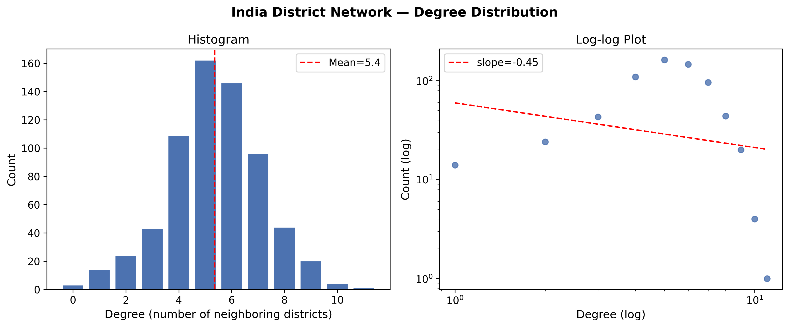
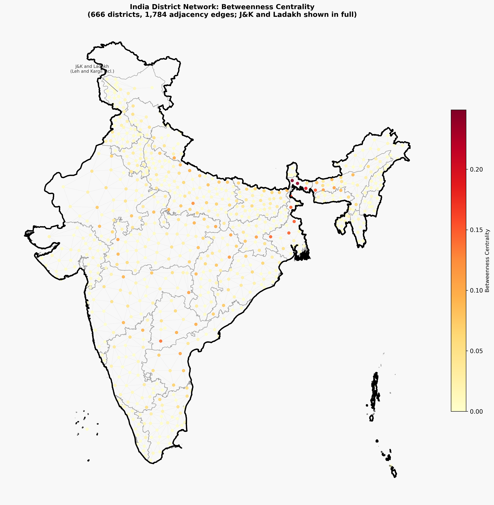
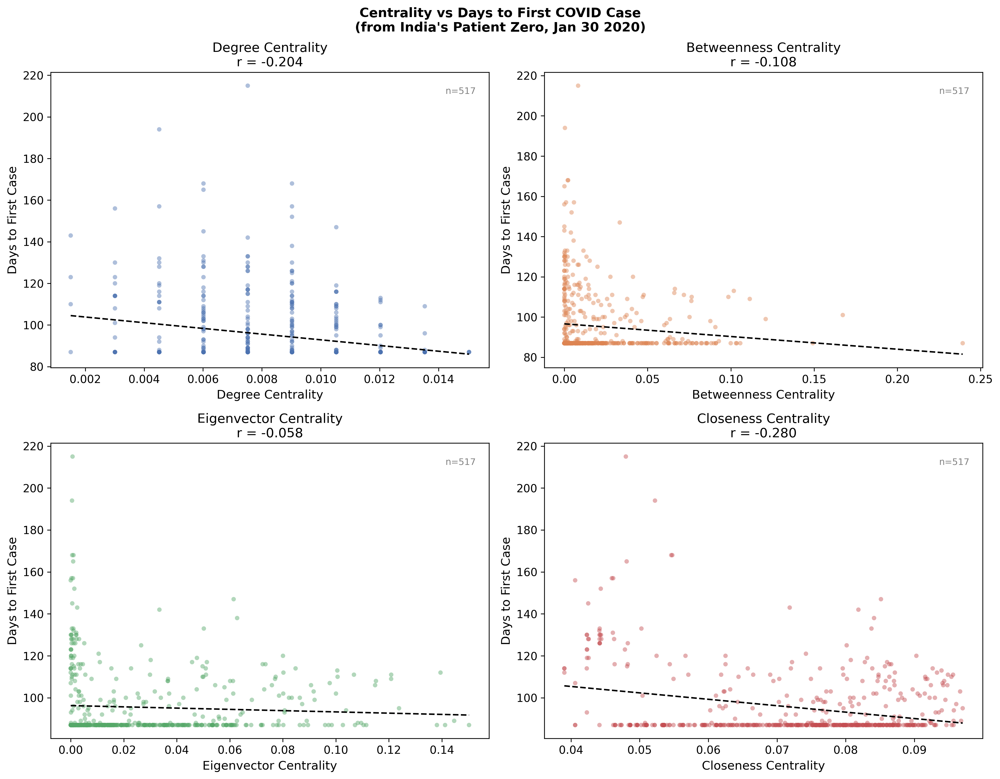
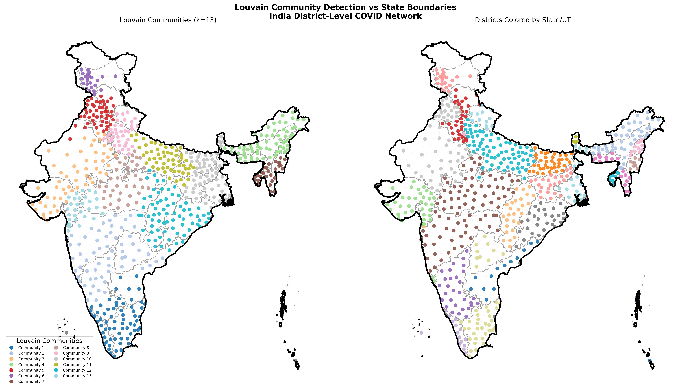
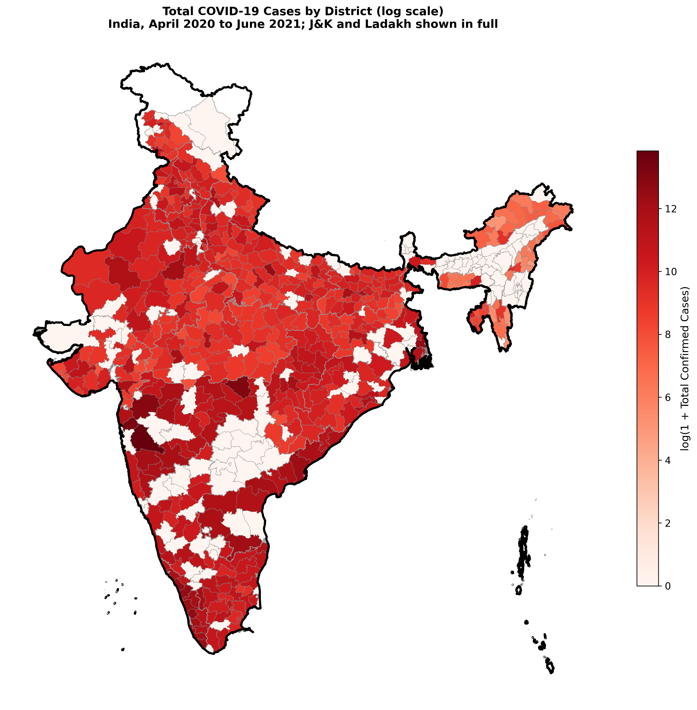

# India District Adjacency Network and COVID-19 Propagation

District-level centrality analysis for India.

[Live dashboard](https://heartfelt-strudel-c454d1.netlify.app) | [Report (PDF)](report/india_covid_network_analysis.pdf)

I built a district adjacency network of India with 666 nodes (districts and union territories) and 1,784 edges, from polygon intersections of GADM Level-2 boundaries. The repo has the written report and an interactive dashboard.

## Background

Disease surveillance in India is mostly organised by state, but districts share people, markets and transport with their neighbours regardless of state lines. Treating each district as a node and each shared border as an edge gives a map of the routes an infection can actually take. COVID-19 is a good test case because almost every district reported its first case within a 14-month window (April 2020 to June 2021), so network position can be compared directly with arrival time.

## Findings

The network is a near-planar geographic lattice with a unimodal degree distribution (mean degree 5.36, max 11). It isn't scale-free, which is what you'd expect for a planar graph given Euler's bound.

Closeness centrality is the best predictor of how early a district got its first case (Pearson r = -0.28, n = 517). Degree is next (r = -0.20). Betweenness and eigenvector centrality are weaker. Eigenvector values pile up near zero because the network has seven connected components and the mass sits on the largest one.

The Siliguri Corridor in northern West Bengal is the main chokepoint. Darjeeling, Jalpaiguri, Koch Bihar and Uttar Dinajpur have the four highest betweenness values, 40 to 65 percent above any other region. They are the only land link between the North-East and the rest of the country, so every shortest path from the North-East to peninsular India goes through them.

Louvain finds 13 communities whose boundaries follow corridors, rivers and mountain ranges rather than state lines, so surveillance zones based on geography would make more sense than state-wise ones.

## Dashboard

The dashboard is live at [heartfelt-strudel-c454d1.netlify.app](https://heartfelt-strudel-c454d1.netlify.app) and has five scenarios on the same 666-district network:

1. COVID Spread: SIR simulation from a patient zero you pick, spreading day by day over the adjacency graph.
2. Network Failure: remove districts and watch how losing high-betweenness nodes breaks the network apart.
3. Healthcare Access: districts coloured by hop distance to the nearest hub (the top betweenness districts).
4. Disaster Relief Logistics: place warehouses and see which districts are left uncovered.
5. Rural Connectivity: add an edge and see how much one new road connection reduces isolation for remote districts.

It's a single standalone HTML file (D3.js from a CDN, data embedded as JSON), so there's no backend.

## Figures

### Figure 1. Degree distribution


Unimodal, peaking at degree 5 to 6, mean 5.36. The log-log panel isn't a straight line, so it's not scale-free.

### Figure 2. Geographic network and betweenness centrality


Nodes at district centroids, coloured by betweenness. The Siliguri Corridor districts stand out.

### Figure 3. Centrality versus arrival time


All four centrality measures correlate negatively with days to first case. Closeness is the strongest.

### Figure 4. Louvain communities versus state boundaries


Communities (left) are geographically compact and often cross state lines (right).

### Figure 5. Total COVID cases by district


Total confirmed cases on a log scale, April 2020 to June 2021. Maharashtra, Kerala, Karnataka, Tamil Nadu and Uttar Pradesh have the most cases.

## Methods

Boundaries are from GADM v4.1 Level-2: 676 polygon features (666 distinct districts, 10 are multi-polygon), including all of Jammu and Kashmir and Ladakh. Two districts share an edge if their boundaries intersect or touch, with a 500 m buffer for districts that only meet at a point or a very short segment. Intersections use a Shapely STRtree in UTM Zone 43N (EPSG:32643).

Centrality: degree, betweenness (Brandes, k = 200 sampled sources), eigenvector on the full graph, and closeness on the largest connected component (657 nodes). Louvain uses random seed 42. Pearson correlations with days to first case use the 517 districts with complete data.

Case data is from the covid19india.org volunteer archive, April 2020 to June 2021. Of the 522 districts with case data, 5 have no verifiable first-case date and are left out of the correlations. 144 districts have no case counts in the source, including the island UTs and 6 J&K districts (Badgam, Bandipore, Kargil, Leh, Poonch, Shopian).

## Layout

```
.
  README.md
  LICENSE
  report/
    india_covid_network_analysis.pdf
  dashboard/
    critical_nodes_simulator.html
  figures/
    fig1_degree_distribution.png
    fig2_network_map.png
    fig3_centrality_vs_timing.png
    fig4_communities.png
    fig5_cases_choropleth.png
  scripts/
    regenerate_compliance_figs.py
```

## Report

The PDF is at `report/india_covid_network_analysis.pdf` and also on [Academia.edu](https://telaviv.academia.edu/SanjanaSingh).

Citation:

> Singh, S. (2026). *India's District Adjacency Network and COVID-19 Propagation: A Centrality Analysis.*

## Author

Sanjana Singh

## Acknowledgements

District case data: covid19india.org volunteer collective (archived). District boundaries: GADM v4.1 ([gadm.org](https://gadm.org)). Analysis used NetworkX, python-louvain, GeoPandas and Shapely.

## License

MIT. See `LICENSE`.
